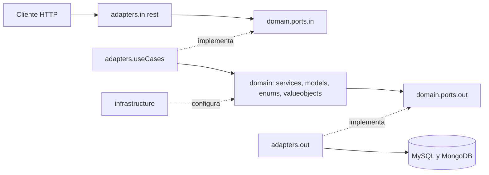

# Arquitectura de software — NexusMarket

## 1. Visión general

NexusMarket es una API REST de un marketplace. Vendedores, compradores, operadores logísticos,
administradores y supervisores participan en un mismo flujo: incorporación del vendedor, catálogo,
inventario, publicación, compra, pago, logística, entrega y posventa.

El sistema sigue una **arquitectura hexagonal** (puertos y adaptadores) con principios de
**diseño guiado por el dominio** (DDD). El objetivo es que las reglas del negocio no dependan de
frameworks, bases de datos ni protocolos.

## 2. Principios

- **El dominio primero:** las reglas de negocio viven en entidades, enums y value objects.
- **Inversión de dependencias:** el dominio define puertos y los adaptadores los implementan.
- **Independencia tecnológica:** se puede cambiar una base de datos sin tocar el dominio.
- **Valores acotados con tipos:** los estados y las categorías son enums o value objects, nunca
  `String` ni `boolean`.
- **Entidades con comportamiento:** cada entidad protege sus invariantes y valida sus transiciones.
- **Código en inglés:** clases, métodos, mensajes y comentarios están en inglés. Este SDD está en
  español y conserva los nombres exactos del código.

## 3. Tecnologías

| Tema | Tecnología |
|---|---|
| Lenguaje | Java 17 |
| Framework | Spring Boot 4.1.1 (Web MVC, Data JPA, Data MongoDB, Security) |
| Base relacional | MySQL 8.0 |
| Base documental | MongoDB 7.0 |
| Autenticación | JWT firmado con JJWT y revocación mediante base de tokens |
| Contraseñas | BCrypt |
| Construcción | Maven (`mvnw.cmd`) |
| Despliegue | Docker y Docker Compose |
| Pruebas de API | Colección de Postman |

## 4. Capas y regla de dependencias



Las dependencias siempre apuntan hacia el dominio. `application.domain` no importa Spring, Lombok,
Jakarta ni ninguna clase de `adapters` o `infrastructure`.

## 5. Estructura de paquetes

```text
nexusm/src/main/java/application/
├── NexusmarketApplication.java
├── adapters/
│   ├── in/rest/
│   │   ├── controllers/
│   │   ├── mappers/
│   │   ├── requests/
│   │   ├── responses/
│   │   └── security/
│   ├── out/
│   │   ├── events/
│   │   ├── persistence/
│   │   │   ├── mongodb/{adapters,documents,mappers,repositories}/
│   │   │   └── mysql/{adapters,entities,mappers,repositories}/
│   │   ├── security/
│   │   └── system/
│   └── useCases/
├── domain/
│   ├── enums/
│   ├── events/
│   ├── exceptions/
│   ├── models/
│   ├── ports/{in,out}/
│   ├── services/{authorization,cart,inventory,invoice,order,product,refund,returns,shipment,user,warehouse}/
│   └── valueobjects/
└── infrastructure/
    ├── config/
    ├── database/
    └── security/
```

## 6. Responsabilidades

### 6.1 `domain`

Es el núcleo del sistema y contiene las reglas de negocio.

| Paquete | Contenido | Documento |
|---|---|---|
| `models` | Entidades, agregados y registros del dominio | [Domain Model](../domain/Domain%20Model.md) |
| `valueobjects` | Objetos inmutables que se validan solos | [Domain Value Objects](../domain/Domain%20Value%20Objects.md) |
| `enums` | Valores acotados y sus transiciones | [Domain Value Objects](../domain/Domain%20Value%20Objects.md) |
| `services` | Un servicio por caso de uso, en subpaquetes por tema | [Services](../domain/Services.md) |
| `events` | Hechos relevantes del negocio | [Domain Model](../domain/Domain%20Model.md) |
| `exceptions` | Errores del negocio | [Domain Model](../domain/Domain%20Model.md) |
| `ports.in` | Operaciones que el sistema ofrece | [Input-ports](../domain/Input-ports.md) |
| `ports.out` | Lo que el dominio necesita del exterior | [Output-ports](../domain/Output-ports.md) |

Los servicios de dominio usan `DomainService`, una anotación propia del dominio escrita en Java puro.
`infrastructure/config/ApplicationConfig` la escanea y registra cada servicio como bean. Reciben al
usuario como actor y validan su rol y la propiedad de los datos (RG-03).

### 6.2 `adapters.useCases`

Hay una clase por puerto de entrada: `PublicAccessUseCase`, `AccountUseCase`, `BuyerUseCase`,
`SellerUseCase`, `LogisticsOperatorUseCase`, `AdministratorUseCase` y `SupervisorUseCase`. Cada una
obtiene al actor con `ResolveActorService` y delega en los servicios de dominio. Además, definen la
transacción con `Transactional`: las escrituras usan una transacción normal y las consultas una de solo
lectura.

### 6.3 `adapters.in.rest`

Expone la API HTTP. Los controladores no contienen reglas de negocio y solo llaman a puertos de entrada.
Hoy solo existe `AuthController`, con el registro de comprador, el login y el logout. Los controladores
por rol llegan en la Fase 4.

| Paquete | Responsabilidad |
|---|---|
| `controllers` | Reciben la petición, llaman al puerto de entrada y devuelven la respuesta |
| `requests` | DTO de entrada |
| `responses` | DTO de salida; ocultan el modelo interno |
| `mappers` | Convierten entre DTO y objetos del dominio |
| `security` | Filtro JWT, usuario autenticado y respuestas de error de seguridad |

### 6.4 `adapters.out`

Implementa los puertos de salida.

| Paquete | Responsabilidad |
|---|---|
| `persistence.mysql` | Usuarios, productos, bodegas, inventario, carritos, pedidos, facturas, envíos, devoluciones y reembolsos |
| `persistence.mongodb` | Bitácora de auditoría, historial de stock y tokens emitidos |
| `security` | `BCryptPasswordEncoderAdapter` y `JjwtTokenProviderAdapter` |
| `events` | `SpringDomainEventPublisherAdapter` y `DomainEventAuditListener` |
| `system` | `SystemClockAdapter`, `UuidGeneratorAdapter` y `LoggingNotificationAdapter` |

### 6.5 `infrastructure`

| Clase | Responsabilidad |
|---|---|
| `config/ApplicationConfig` | Registra los servicios de dominio como beans |
| `config/AdminSeeder` | Crea el administrador inicial al arrancar, si no existe |
| `database/DatabaseConfig` | Crea los índices de `issued_tokens` en MongoDB: el TTL de `expiresAt` y el de `userId` |
| `security/SecurityConfig` | Reglas de acceso HTTP y sesión sin estado |

## 7. Persistencia

| Base | Datos | Motivo |
|---|---|---|
| MySQL | Usuarios, productos, bodegas, inventario, carritos, pedidos, facturas, envíos, devoluciones y reembolsos | Datos relacionales que requieren integridad |
| MongoDB | Auditoría, historial de stock y tokens | Registros de solo adición; los tokens expiran con un índice TTL |

Cada agregado de MySQL tiene su entidad JPA, su repositorio de Spring Data, su mapper y su adaptador,
en `persistence.mysql`. Las tablas de los agregados nuevos son `carts`, `cart_items`, `invoices`,
`shipments`, `return_requests` y `refunds`.

La base de datos también protege estas reglas con restricciones únicas: un carrito por comprador, una
factura por pedido, un número por factura y un envío por bodega en cada pedido.

Las columnas de estado, tipo y rol usan el enum del dominio con `@Enumerated(EnumType.STRING)`. Se
declaran con `columnDefinition = "VARCHAR(20)"` para que MySQL guarde el nombre de la constante en una
columna de texto, sin un tipo `ENUM` nativo ni restricciones `CHECK`: así, un valor nuevo del enum no
exige cambiar la tabla.

Las pruebas usan H2 con un dialecto sin restricciones `CHECK`, y las clases `*IT` repiten la persistencia sobre el
MySQL y el MongoDB reales.

## 8. Seguridad y reglas generales

| Regla | Descripción | Cómo se aplica |
|---|---|---|
| RG-01 | Toda operación requiere un usuario autenticado, salvo el catálogo público y el registro de comprador | `SecurityConfig` y filtro JWT |
| RG-02 | Cada usuario tiene un solo rol | `User.role` es inmutable y `UserRole` define los 5 roles |
| RG-03 | Nadie maneja información fuera de su rol | `User.requireRole` y métodos de propiedad como `Order.requireBelongsTo` y `Product.requireOwnedBy` |

Autenticación:

1. El usuario inicia sesión y el sistema emite un JWT.
2. El sistema guarda un `IssuedToken` en estado `ACTIVE`.
3. En cada petición se verifican la firma, la expiración y el estado del token.
4. Al cerrar sesión, el token pasa a `REVOKED` y se rechaza aunque no haya expirado.
5. Al cambiar la contraseña, `ChangePasswordService` revoca todos los tokens activos del usuario con
   `TokenStorePort.revokeAllForUser`, incluida la sesión actual.

El JWT lleva el rol del usuario, y `JwtAuthenticationFilter` lo convierte en una autoridad con el prefijo `ROLE_`
de Spring Security. Son los 5 valores de `UserRole`. `AdminSeeder` crea el administrador inicial con el
rol `ADMINISTRATOR`. La autenticación es solo con JWT: la configuración excluye el usuario en
memoria que Spring Security crearía por defecto.

## 9. Eventos de dominio

Los servicios de dominio publican eventos mediante `DomainEventPublisherPort`. `DomainEventAuditListener` los
escucha y los guarda en la bitácora mediante `AuditLogPort`. Así, la auditoría queda desacoplada de la
lógica de negocio.

## 10. Despliegue

`docker-compose.yml` levanta tres servicios:

| Servicio | Imagen | Puerto |
|---|---|---|
| `mysql` | `mysql:8.0` | 3306 |
| `mongo` | `mongo:7.0` | 27017 |
| `api` | Construida desde `nexusm/` | 8080 |

La API espera a que ambas bases estén saludables. Sus datos de conexión, la clave JWT y las
credenciales del administrador inicial se pasan por variables de entorno.

## 11. Estado de transición

Este documento describe el código actual. Estos cambios ya están planeados:

| Fase | Cambio |
|---|---|
| 4 | Un controlador por rol bajo `/api/v1` |
| 5 | Bloqueo optimista y escrituras en MongoDB después del commit |
