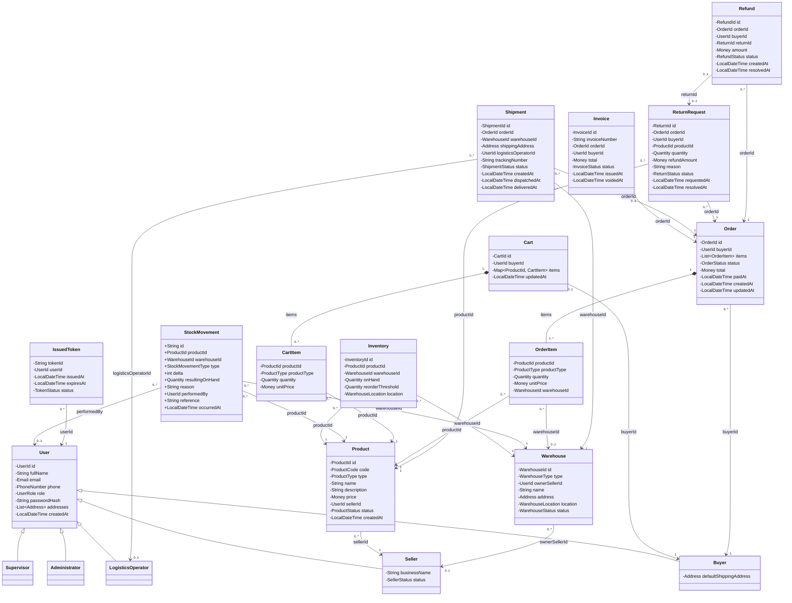

# Modelo de dominio — NexusMarket

## 1. Introducción

Este documento describe las entidades de `application.domain.models`. Los nombres de clases,
atributos y métodos son idénticos a los del código. Los tipos auxiliares están en
[Domain Value Objects](Domain%20Value%20Objects.md).

**Alcance.** Cubre el flujo completo del marketplace: incorporación del vendedor, catálogo, inventario,
publicación, compra, pago, logística, entrega y posventa.

**Reglas generales.**

| Regla | Descripción |
|---|---|
| RG-01 | Toda operación requiere un usuario autenticado, salvo el catálogo público y el registro de comprador |
| RG-02 | Cada usuario tiene un solo rol |
| RG-03 | Nadie maneja información fuera de su rol |

**Convenciones.** Las entidades se relacionan por identificador tipado, no por referencia directa.
`Order`, por ejemplo, guarda `buyerId` y no un objeto `Buyer`. Solo `Cart` y `Order` contienen objetos
hijos, porque son raíces de agregado.

## 2. Diagrama de clases

Las flechas con rombo indican composición. Las demás indican una referencia por identificador, y su
etiqueta es el atributo que la guarda.

## 3. Usuarios

### 3.1 `User`

**Descripción.** Entidad base de todos los usuarios del sistema.

| Atributo | Tipo | Mutable |
|---|---|---|
| `id` | `UserId` | No |
| `fullName` | `String` | Sí |
| `email` | `Email` | No |
| `phone` | `PhoneNumber` | Sí |
| `role` | `UserRole` | No |
| `passwordHash` | `String` | Sí |
| `addresses` | `List<Address>` | Sí |
| `createdAt` | `LocalDateTime` | No |

| Comportamiento | Descripción |
|---|---|
| `changeName(String)` | Cambia el nombre; no admite vacío |
| `changePhone(PhoneNumber)` | Cambia el teléfono |
| `changePasswordHash(String)` | Cambia el hash de la contraseña |
| `addAddress(Address)` | Agrega una dirección |
| `removeAddress(Address)` | Elimina una dirección; falla si no está registrada |
| `hasAddress(Address)` | Indica si la dirección está registrada |
| `hasRole(UserRole)` | Indica si el usuario tiene el rol dado |
| `requireRole(UserRole)` | Falla con `ForbiddenActionException` si el usuario tiene otro rol (RG-03) |
| `requireAnyRole(UserRole...)` | Falla si el usuario no tiene ninguno de los roles dados (RG-03) |
| `isBuyer()`, `isSeller()`, `isLogisticsOperator()`, `isAdministrator()`, `isSupervisor()` | Consultas de rol |

**Reglas.**
- `id`, `email` y `role` no cambian.
- `fullName`, `email`, `phone` y `role` son obligatorios.
- El rol es fijo y determina la subclase (RG-02).
- El correo debe ser único; lo valida el caso de uso con `UserRepository`.

**Relaciones.** Es la superclase de `Buyer`, `Seller`, `LogisticsOperator`, `Administrator` y
`Supervisor`. `IssuedToken` y `StockMovement` lo referencian.

### 3.2 `Buyer`

**Descripción.** Usuario con rol `BUYER`. Es el único rol que se registra por la API pública.

| Atributo | Tipo |
|---|---|
| `defaultShippingAddress` | `Address` |

| Comportamiento | Descripción |
|---|---|
| `create(...)` | Crea un comprador con un id nuevo |
| `changeDefaultShippingAddress(Address)` | Cambia la dirección de envío predeterminada |

**Reglas.** `defaultShippingAddress` es obligatoria.

**Relaciones.** Tiene un `Cart` y puede tener varios `Order`, `Invoice`, `ReturnRequest` y `Refund`.

### 3.3 `Seller`

**Descripción.** Usuario con rol `SELLER`. Nace pendiente de aprobación.

| Atributo | Tipo |
|---|---|
| `businessName` | `String` |
| `status` | `SellerStatus` |

| Comportamiento | Descripción |
|---|---|
| `register(...)` | Crea el vendedor en `PENDING_APPROVAL` |
| `approve()` | Aprueba al vendedor o levanta su suspensión |
| `suspend()` | Suspende a un vendedor aprobado |
| `changeBusinessName(String)` | Cambia el nombre comercial |
| `isApproved()` | Indica si está en `APPROVED` |
| `requireApprovedToPublish()` | Falla si no puede publicar productos |

**Reglas.**
- `businessName` y `status` son obligatorios.
- Solo un vendedor `APPROVED` puede publicar productos.
- Las transiciones se validan en `SellerStatus`.
- La igualdad se calcula por `id`.

**Relaciones.** Tiene varios `Product` y puede ser dueño de `Warehouse` de tipo `SELLER`.

### 3.4 `LogisticsOperator`

**Descripción.** Usuario con rol `LOGISTICS_OPERATOR`. Registra y ajusta inventario, y crea, despacha y
entrega envíos. Lo registra un administrador.

**Relaciones.** Queda asociado a cada `Shipment` que despacha.

### 3.5 `Administrator`

**Descripción.** Usuario con rol `ADMINISTRATOR`. Registra vendedores y personal interno, gestiona las
bodegas del marketplace y aprueba devoluciones y reembolsos.

**Reglas.** El primer administrador no se registra por la API: `AdminSeeder` lo crea al arrancar.
Consulta el inventario, pero no lo modifica (RG-03): eso corresponde al vendedor, en sus bodegas, y al
operador logístico.

### 3.6 `Supervisor`

**Descripción.** Usuario con rol `SUPERVISOR`. Consulta toda la información y los reportes, pero no
modifica datos del negocio. Lo registra un administrador.

| Comportamiento | Descripción |
|---|---|
| `canModifyBusinessData()` | Siempre devuelve `false` |

## 4. Catálogo e inventario

### 4.1 `Product`

**Descripción.** Producto que un vendedor registra en el catálogo.

| Atributo | Tipo | Mutable |
|---|---|---|
| `id` | `ProductId` | No |
| `code` | `ProductCode` | No |
| `type` | `ProductType` | No |
| `name` | `String` | Sí |
| `description` | `String` | Sí |
| `price` | `Money` | Sí |
| `sellerId` | `UserId` | No |
| `status` | `ProductStatus` | Sí |
| `createdAt` | `LocalDateTime` | No |

| Comportamiento | Descripción |
|---|---|
| `register(...)` | Crea el producto en `DRAFT` |
| `publish()` | Lo hace visible en el catálogo público |
| `suspend()` | Lo retira temporalmente del catálogo; falla si está bloqueado |
| `block()` | Lo retira del catálogo por decisión de un administrador |
| `unblock()` | Levanta el bloqueo y lo deja en `SUSPENDED`; falla si no está bloqueado |
| `discontinue()` | Lo retira definitivamente de la venta |
| `changePrice(Money)` | Cambia el precio |
| `rename(String)` | Cambia el nombre |
| `changeDescription(String)` | Cambia la descripción |
| `isOwnedBy(UserId)` | Indica si pertenece al vendedor dado (RG-03) |
| `requireOwnedBy(UserId)` | Falla con `ForbiddenActionException` si pertenece a otro vendedor |
| `isActive()` | Consulta derivada: indica si se puede mostrar y comprar |

**Reglas.**
- `price` debe ser mayor que cero y su moneda no cambia.
- Solo se venden productos `PUBLISHED` de vendedores `APPROVED`.
- Solo un administrador bloquea y desbloquea un producto.
- Un producto `DISCONTINUED` no se puede editar.
- Las transiciones se validan en `ProductStatus`.

**Relaciones.** Pertenece a un `Seller`. Lo referencian `Inventory`, `StockMovement`, `CartItem`,
`OrderItem` y `ReturnRequest`.

### 4.2 `Warehouse`

**Descripción.** Bodega física donde se guarda el inventario.

| Atributo | Tipo | Mutable |
|---|---|---|
| `id` | `WarehouseId` | No |
| `type` | `WarehouseType` | No |
| `ownerSellerId` | `UserId` (opcional) | No |
| `name` | `String` | Sí |
| `address` | `Address` | Sí |
| `location` | `WarehouseLocation` | Sí |
| `status` | `WarehouseStatus` | Sí |

| Comportamiento | Descripción |
|---|---|
| `createMarketplaceWarehouse(...)` | Crea una bodega activa del marketplace |
| `createSellerWarehouse(...)` | Crea una bodega activa de un vendedor |
| `changeName(String)`, `changeAddress(Address)`, `changeLocation(WarehouseLocation)` | Actualizan sus datos |
| `activate()`, `deactivate()` | Cambian el estado; fallan si ya está en ese estado |
| `isActive()` | Consulta derivada: indica si puede guardar y despachar inventario |
| `isOwnedBy(UserId)` | Indica si pertenece al vendedor dado (RG-03) |
| `requireManagedBy(User)` | Exige al dueño en una bodega `SELLER` y a un administrador en una `MARKETPLACE` |

**Reglas.**
- Una bodega `SELLER` siempre tiene dueño.
- Una bodega `MARKETPLACE` nunca tiene dueño.
- Solo las bodegas `ACTIVE` reciben stock y despachan pedidos.

**Relaciones.** Puede pertenecer a un `Seller`. La referencian `Inventory`, `StockMovement`, `OrderItem`
y `Shipment`.

### 4.3 `Inventory`

**Descripción.** Stock disponible de un producto en una bodega.

| Atributo | Tipo | Mutable |
|---|---|---|
| `id` | `InventoryId` | No |
| `productId` | `ProductId` | No |
| `warehouseId` | `WarehouseId` | No |
| `onHand` | `Quantity` | Sí |
| `reorderThreshold` | `Quantity` | Sí |
| `location` | `WarehouseLocation` | No |

| Comportamiento | Descripción |
|---|---|
| `create(...)` | Crea el inventario con un id nuevo |
| `increase(Quantity)` | Aumenta el stock |
| `decrease(Quantity)` | Disminuye el stock; falla si no alcanza |
| `isAvailable(Quantity)` | Indica si hay stock suficiente |
| `isBelowReorderPoint()` | Indica si `onHand` es menor que `reorderThreshold` |
| `changeReorderThreshold(Quantity)` | Cambia el punto de reorden |

**Reglas.**
- El par (`productId`, `warehouseId`) identifica el inventario de forma única.
- `onHand` nunca es negativo.
- Si `onHand` cae por debajo de `reorderThreshold`, el caso de uso publica `LowStockEvent`.

**Relaciones.** Une un `Product` con un `Warehouse`.

### 4.4 `StockMovement`

**Descripción.** Registro inmutable de un movimiento de stock. Es un `record`.

| Atributo | Tipo | Descripción |
|---|---|---|
| `id` | `String` | Identificador |
| `productId` | `ProductId` | Producto |
| `warehouseId` | `WarehouseId` | Bodega |
| `type` | `StockMovementType` | Tipo de movimiento |
| `delta` | `int` | Cambio aplicado: positivo si entra, negativo si sale |
| `resultingOnHand` | `Quantity` | Stock que queda después del movimiento |
| `reason` | `String` | Motivo |
| `performedBy` | `UserId` | Autor; `null` si lo hizo el sistema |
| `reference` | `String` | Referencia opcional, como el id del pedido |
| `occurredAt` | `LocalDateTime` | Fecha |

**Reglas.**
- Todo movimiento tiene un motivo.
- El signo de `delta` debe coincidir con `type`, salvo en `ADJUSTMENT`, que admite ambos.

**Relaciones.** Referencia un `Product`, un `Warehouse` y, opcionalmente, un `User`.

## 5. Compra

### 5.1 `Cart`

**Descripción.** Carrito de un comprador. Es raíz de agregado.

| Atributo | Tipo |
|---|---|
| `id` | `CartId` |
| `buyerId` | `UserId` |
| `items` | `Map<ProductId, CartItem>` |
| `updatedAt` | `LocalDateTime` |

| Comportamiento | Descripción |
|---|---|
| `createFor(...)` | Crea el carrito vacío de un comprador |
| `addItem(ProductId, ProductType, Quantity, Money)` | Agrega un producto; si ya existe, suma la cantidad |
| `changeQuantity(ProductId, Quantity)` | Cambia la cantidad; con cero, elimina el producto |
| `removeItem(ProductId)` | Quita un producto; falla si no está en el carrito |
| `clear()` | Vacía el carrito |
| `checkout(OrderId, LocalDateTime)` | Crea un `Order` en `PENDING_PAYMENT` y vacía el carrito |
| `total()` | Suma de subtotales; vacío si no hay productos |
| `isEmpty()` | Indica si el carrito está vacío |
| `belongsTo(UserId)` | Indica si pertenece al usuario (RG-03) |

**Reglas.**
- Cada comprador tiene un solo carrito.
- Un producto nunca ocupa dos líneas.
- Un carrito vacío no se convierte en pedido.

**Relaciones.** Pertenece a un `Buyer`, contiene `CartItem` y genera un `Order`.

### 5.2 `CartItem`

**Descripción.** Línea inmutable del carrito. `unitPrice` es el precio del catálogo en el momento de
agregar el producto.

| Atributo | Tipo |
|---|---|
| `productId` | `ProductId` |
| `productType` | `ProductType` |
| `quantity` | `Quantity` |
| `unitPrice` | `Money` |

| Comportamiento | Descripción |
|---|---|
| `withQuantity(Quantity)` | Devuelve una copia con otra cantidad |
| `subtotal()` | `unitPrice` por `quantity` |
| `toOrderItem()` | Convierte la línea en un `OrderItem` |

**Reglas.** `quantity` debe ser mayor que cero.

**Relaciones.** Es parte de `Cart` y referencia un `Product`.

### 5.3 `Order`

**Descripción.** Pedido de compra. Es raíz de agregado.

| Atributo | Tipo | Mutable |
|---|---|---|
| `id` | `OrderId` | No |
| `buyerId` | `UserId` | No |
| `items` | `List<OrderItem>` | Sí |
| `status` | `OrderStatus` | Sí |
| `total` | `Money` | Sí |
| `paidAt` | `LocalDateTime` (opcional) | Sí |
| `createdAt` | `LocalDateTime` | No |
| `updatedAt` | `LocalDateTime` | Sí |

| Comportamiento | Descripción |
|---|---|
| `create(...)` | Crea el pedido en `PENDING_PAYMENT` |
| `addItem(OrderItem)` | Agrega una línea mientras el pedido está pendiente de pago |
| `assignWarehouses(Map)` | Asigna la bodega de cada línea que requiere envío, antes del pago |
| `pay(LocalDateTime)` | Registra el pago y guarda `paidAt`; exige bodega en las líneas que requieren envío. Si ningún ítem requiere envío, entrega el pedido |
| `cancel()` | Pasa el pedido a `CANCELLED` |
| `applyShipmentProgress(List)` | Único medio para pasar a `SHIPPED` y a `DELIVERED` en pedidos con envíos |
| `requiresShipment()` | Indica si algún ítem viaja en un envío |
| `shippingWarehouses()` | Bodegas que deben despachar ítems del pedido |
| `wasPaid()` | Indica si el pedido se pagó, aunque después se haya cancelado |
| `hasReservedStock()` | Indica si mantiene stock reservado |
| `belongsTo(UserId)` | Indica si pertenece al usuario (RG-03) |
| `requireBelongsTo(UserId)` | Falla con `ForbiddenActionException` si pertenece a otro comprador |
| `warehouseOf(ProductId)` | Bodega que despachó el producto |
| `containsAnyProduct(Set)` | Indica si contiene alguno de los productos |
| `unitsByProduct()` | Unidades totales por producto |

**Reglas.**
- Tiene al menos una línea, y cada producto aparece una sola vez.
- `total` siempre es la suma de los subtotales de sus líneas.
- Las transiciones se validan en `OrderStatus`; si no son válidas, se lanza
  `OrderStateTransitionException`.
- Solo se cancela desde `PENDING_PAYMENT` o `PAID`.
- Cada bodega del pedido tiene su propio `Shipment`.
- Pasa a `SHIPPED` cuando existe un envío por cada bodega y todos cumplen `ShipmentStatus.hasLeftWarehouse()`.
- Pasa a `DELIVERED` cuando todos sus envíos están `DELIVERED`.
- Un pedido sin ítems que requieran envío pasa de `PAID` a `DELIVERED` directamente.

**Relaciones.** Pertenece a un `Buyer` y contiene `OrderItem`. Lo referencian `Invoice`, `Shipment`,
`ReturnRequest` y `Refund`.

### 5.4 `OrderItem`

**Descripción.** Línea del pedido, con el precio efectivo en el momento de la compra.

| Atributo | Tipo |
|---|---|
| `productId` | `ProductId` |
| `productType` | `ProductType` |
| `quantity` | `Quantity` |
| `unitPrice` | `Money` |
| `warehouseId` | `WarehouseId` (opcional) |

| Comportamiento | Descripción |
|---|---|
| `subtotal()` | `unitPrice` por `quantity` |
| `assignedTo(WarehouseId)` | Devuelve una copia asignada a la bodega |
| `hasWarehouse()` | Indica si ya tiene bodega |
| `requiresShipment()` | Indica si toma stock de una bodega y viaja en un envío |
| `isReturnable()` | Indica si admite devolución |

**Reglas.** `quantity` debe ser mayor que cero. `warehouseId` es `null` hasta que se asigna, antes del
pago. Los ítems que no requieren envío nunca tienen bodega.

**Relaciones.** Es parte de `Order` y referencia un `Product` y un `Warehouse`.

### 5.5 `Invoice`

**Descripción.** Factura de un pedido pagado.

| Atributo | Tipo | Mutable |
|---|---|---|
| `id` | `InvoiceId` | No |
| `invoiceNumber` | `String` | No |
| `orderId` | `OrderId` | No |
| `buyerId` | `UserId` | No |
| `total` | `Money` | No |
| `status` | `InvoiceStatus` | Sí |
| `issuedAt` | `LocalDateTime` | No |
| `voidedAt` | `LocalDateTime` | Sí |

| Comportamiento | Descripción |
|---|---|
| `issueFor(Order, InvoiceId, String, LocalDateTime)` | Emite la factura; exige un pedido pagado y no cancelado |
| `voidInvoice(LocalDateTime)` | Anula la factura |
| `belongsTo(UserId)` | Indica si pertenece al usuario (RG-03) |

**Reglas.**
- Solo se factura un pedido pagado y no cancelado, y un pedido tiene una sola factura.
- `total` es el total del pedido.
- Una factura `VOIDED` no cambia más.

**Relaciones.** Referencia un `Order` y un `Buyer`.

## 6. Logística

### 6.1 `Shipment`

**Descripción.** Envío de un pedido pagado desde una bodega, a cargo de un operador logístico.

| Atributo | Tipo | Mutable |
|---|---|---|
| `id` | `ShipmentId` | No |
| `orderId` | `OrderId` | No |
| `warehouseId` | `WarehouseId` | No |
| `shippingAddress` | `Address` | No |
| `logisticsOperatorId` | `UserId` (opcional) | Sí |
| `trackingNumber` | `String` (opcional) | Sí |
| `status` | `ShipmentStatus` | Sí |
| `createdAt` | `LocalDateTime` | No |
| `dispatchedAt` | `LocalDateTime` (opcional) | Sí |
| `deliveredAt` | `LocalDateTime` (opcional) | Sí |

| Comportamiento | Descripción |
|---|---|
| `prepareFor(...)` | Crea el envío en `PREPARING`; exige un pedido `PAID` y una bodega del pedido |
| `pack()` | Marca el envío como empacado |
| `dispatch(UserId, String, LocalDateTime)` | Entrega el envío al transportador |
| `confirmDelivery(LocalDateTime)` | Confirma que el comprador lo recibió |

**Reglas.**
- Solo se crea para un pedido `PAID`, desde una de sus bodegas.
- Cada bodega de un pedido tiene su propio envío.
- Para despacharlo se exigen operador y número de guía.
- Las transiciones se validan en `ShipmentStatus`.

**Relaciones.** Referencia un `Order`, un `Warehouse` y un `LogisticsOperator`.

## 7. Posventa

### 7.1 `ReturnRequest`

**Descripción.** Devolución que pide un comprador sobre un producto de un pedido entregado.

| Atributo | Tipo | Mutable |
|---|---|---|
| `id` | `ReturnId` | No |
| `orderId` | `OrderId` | No |
| `buyerId` | `UserId` | No |
| `productId` | `ProductId` | No |
| `quantity` | `Quantity` | No |
| `refundAmount` | `Money` | No |
| `reason` | `String` | No |
| `status` | `ReturnStatus` | Sí |
| `requestedAt` | `LocalDateTime` | No |
| `resolvedAt` | `LocalDateTime` (opcional) | Sí |

| Comportamiento | Descripción |
|---|---|
| `request(Order, ReturnId, ProductId, Quantity, Quantity, String, LocalDateTime)` | Crea la devolución en `REQUESTED`; recibe la cantidad solicitada y la ya devuelta |
| `approve(LocalDateTime)` | Aprueba la devolución |
| `reject(LocalDateTime)` | Rechaza la devolución |
| `markAsReceived()` | Registra que la bodega recibió el producto |
| `belongsTo(UserId)` | Indica si pertenece al usuario (RG-03) |

**Reglas.**
- Solo se devuelven productos de pedidos `DELIVERED`.
- El producto debe pertenecer al pedido y admitir devolución: los productos `DIGITAL` no la admiten.
- `quantity` debe ser mayor que cero.
- Lo ya devuelto más `quantity` no puede superar lo comprado. El servicio calcula lo ya devuelto sumando las devoluciones no rechazadas de ese producto.
- `reason` es obligatorio.
- `refundAmount` es el precio unitario pagado por la cantidad devuelta.
- El pedido original no se modifica.

**Relaciones.** Referencia un `Order`, un `Buyer` y un `Product`. Puede generar un `Refund`.

### 7.2 `Refund`

**Descripción.** Dinero que se devuelve a un comprador. Lo procesa un administrador.

| Atributo | Tipo | Mutable |
|---|---|---|
| `id` | `RefundId` | No |
| `orderId` | `OrderId` | No |
| `buyerId` | `UserId` | No |
| `returnId` | `ReturnId` (opcional) | No |
| `amount` | `Money` | No |
| `status` | `RefundStatus` | Sí |
| `createdAt` | `LocalDateTime` | No |
| `resolvedAt` | `LocalDateTime` (opcional) | Sí |

| Comportamiento | Descripción |
|---|---|
| `forReturn(ReturnRequest, RefundId, LocalDateTime)` | Crea el reembolso de una devolución `RECEIVED` |
| `forCancelledOrder(Order, RefundId, LocalDateTime)` | Crea el reembolso de un pedido `CANCELLED` que se había pagado |
| `process(LocalDateTime)` | Marca el reembolso como procesado |
| `reject(LocalDateTime)` | Rechaza el reembolso |

**Reglas.**
- `amount` debe ser mayor que cero.
- Un pedido cancelado sin haberse pagado no se reembolsa.
- En una devolución, `amount` es `refundAmount`. En un pedido cancelado, es el total del pedido.
- Las transiciones se validan en `RefundStatus`.

**Relaciones.** Referencia un `Order`, un `Buyer` y, si viene de una devolución, un `ReturnRequest`.

## 8. Autenticación

### 8.1 `IssuedToken`

**Descripción.** Registro de un JWT emitido. Permite revocarlo antes de que expire.

| Atributo | Tipo | Mutable |
|---|---|---|
| `tokenId` | `String` | No |
| `userId` | `UserId` | No |
| `issuedAt` | `LocalDateTime` | No |
| `expiresAt` | `LocalDateTime` | No |
| `status` | `TokenStatus` | Sí |

| Comportamiento | Descripción |
|---|---|
| `issue(...)` | Crea el registro en `ACTIVE` |
| `isUsableAt(LocalDateTime)` | Indica si está activo y sin expirar en ese momento |
| `revoke()` | Revoca el token; falla si ya estaba revocado |

**Reglas.** `expiresAt` debe ser posterior a `issuedAt`.

**Relaciones.** Referencia un `User`.

### 8.2 `TokenClaims`

**Descripción.** Datos que viajan dentro del JWT. Es un `record` con `tokenId`, `userId`, `role`,
`issuedAt` y `expiresAt`, todos obligatorios.

### 8.3 `AuthSession`

**Descripción.** Resultado de un inicio de sesión exitoso. Es un `record` con `token`, `expiresAt` y
`user`, todos obligatorios.

## 9. Agregados

| Agregado | Raíz | Objetos internos |
|---|---|---|
| Carrito | `Cart` | `CartItem` |
| Pedido | `Order` | `OrderItem` |

Las demás entidades son agregados de un solo objeto.

## 10. Servicios de dominio

Los servicios de dominio están en `application.domain.services`, en un subpaquete por tema. La matriz
de trazabilidad está en [Services](Services.md), y el detalle de cada uno en `SDD/domain/services`.

## 11. Eventos de dominio

Todos implementan `DomainEvent`, que expone `occurredAt`.

| Evento | Se publica cuando | Datos |
|---|---|---|
| `OrderCreatedEvent` | Se crea un pedido | `orderId`, `buyerId`, `total` |
| `OrderStatusChangedEvent` | Un pedido cambia de estado | `orderId`, `previousStatus`, `newStatus` |
| `InventoryUpdatedEvent` | Cambia el inventario | `productId`, `warehouseId`, `newOnHand` |
| `LowStockEvent` | El stock cae por debajo del punto de reorden | `productId`, `warehouseId`, `onHand`, `reorderThreshold` |
| `ProductAddedEvent` | Un vendedor agrega un producto | `productId`, `code`, `sellerId` |

## 12. Excepciones

Todas heredan de `DomainException`.

| Excepción | Se lanza cuando |
|---|---|
| `BusinessRuleException` | Se viola una regla de negocio |
| `DuplicateResourceException` | Un recurso ya existe, como un correo o un código de producto |
| `ForbiddenActionException` | Un usuario intenta una acción que no le corresponde |
| `InsufficientStockException` | No hay stock suficiente |
| `InvalidCredentialsException` | El correo o la contraseña no son válidos |
| `InvalidTokenException` | El token es inválido, expiró o fue revocado |
| `OrderStateTransitionException` | Un pedido intenta una transición no permitida |
| `ResourceNotFoundException` | Un recurso no existe |
| `ResourceStateConflictException` | El estado actual de un recurso no permite la operación; hereda de `BusinessRuleException` |

## 13. Flujo del negocio

| Etapa | Entidades | Operaciones |
|---|---|---|
| Incorporación del vendedor | `Seller` | `register`, `approve` |
| Catálogo | `Product` | `register` |
| Inventario | `Warehouse`, `Inventory`, `StockMovement` | `createSellerWarehouse`, `create`, `increase` |
| Publicación | `Product`, `Seller` | `requireApprovedToPublish`, `publish` |
| Compra | `Cart`, `Order` | `addItem`, `checkout` |
| Pago | `Order`, `Invoice` | `assignWarehouses`, `pay`, `issueFor` |
| Logística | `Shipment`, `Order` | `prepareFor`, `pack`, `dispatch`, `applyShipmentProgress` |
| Entrega | `Shipment`, `Order` | `confirmDelivery`, `applyShipmentProgress` |
| Posventa | `ReturnRequest`, `Refund` | `request`, `approve`, `markAsReceived`, `forReturn`, `process` |

## 14. Pendientes temporales

| Tema | Estado actual | Se corrige en |
|---|---|---|
| Escrituras en MongoDB | `@Transactional` solo cubre MySQL; el historial y la auditoría se escribirán después del commit (`AFTER_COMMIT`) | Fase 5 |
