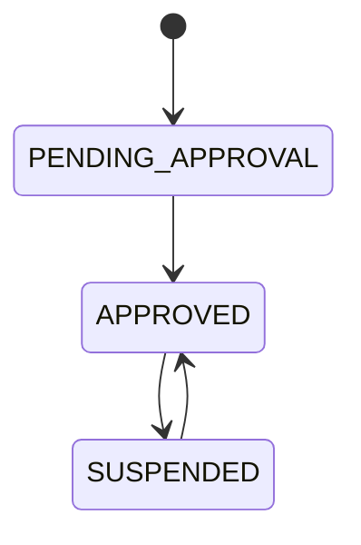
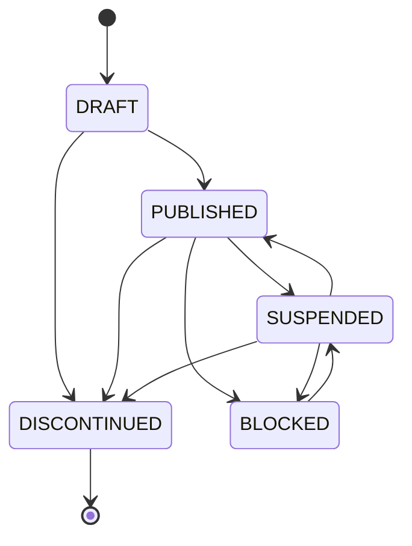
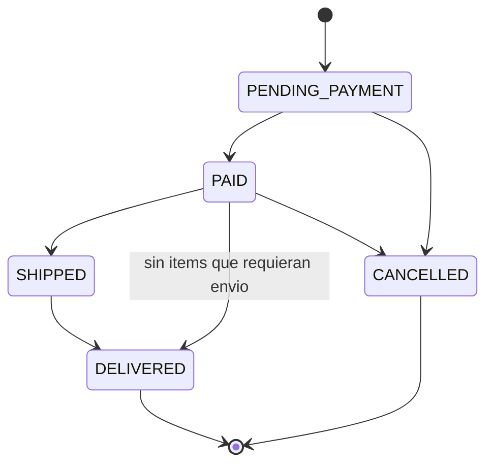
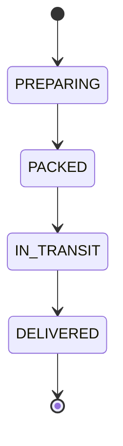
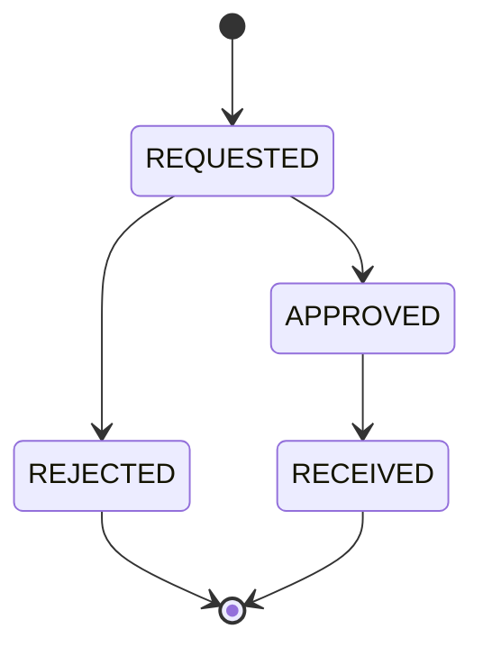
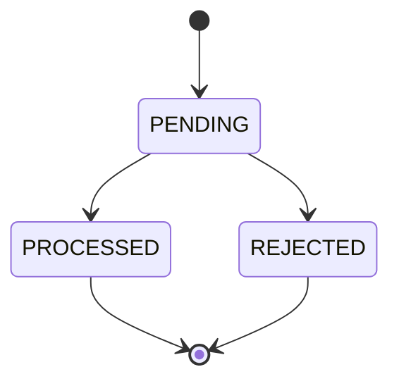

# Value objects y enums — NexusMarket

## 1. Introducción

Este documento describe los value objects de `application.domain.valueobjects` y los enums de
`application.domain.enums`. Los nombres son idénticos a los del código.

Un **value object** no tiene identidad propia: dos objetos con los mismos valores son iguales. Todos
los de NexusMarket cumplen estas reglas:

- **Inmutabilidad:** son clases `final` con atributos `final`.
- **Autovalidación:** no se puede crear un objeto inválido; el constructor lanza una excepción.
- **Igualdad por valor:** implementan `equals` y `hashCode` con sus atributos.

Un **enum** representa un conjunto cerrado de valores. Los enums de estado también deciden qué
transiciones están permitidas, mediante `canTransitionTo` y `requireCanTransitionTo`.

## 2. Value objects

### 2.1 Resumen

| Value object | Representa | Atributos | Fábricas |
|---|---|---|---|
| `Email` | Correo electrónico | `value` | `of` |
| `PhoneNumber` | Teléfono en formato E.164 | `value` | `of` |
| `Money` | Monto con moneda | `amount`, `currency` | `of`, `zero` |
| `Quantity` | Cantidad entera no negativa | `value` | `of`, `zero` |
| `ProductCode` | Código SKU | `value` | `of`, `generate` |
| `Address` | Dirección postal | `street`, `city`, `state`, `zipCode`, `country` | `of` |
| `WarehouseLocation` | Ubicación dentro de una bodega | `aisle`, `shelf`, `bin` | `of` |

### 2.2 `Email`

- No puede ser nulo ni vacío.
- Debe cumplir el patrón `^[A-Za-z0-9._%+-]+@[A-Za-z0-9.-]+\.[A-Za-z]{2,}$`.
- Se normaliza quitando espacios y pasando a minúsculas, de modo que `ANA@correo.com` y
  `ana@correo.com` son iguales.

### 2.3 `PhoneNumber`

- No puede ser nulo ni vacío.
- Se eliminan espacios y guiones antes de validar.
- Debe cumplir E.164: `+` seguido de 2 a 15 dígitos, y el primero no puede ser 0. Patrón:
  `^\+[1-9]\d{1,14}$`.

### 2.4 `Money`

- `amount` y `currency` son obligatorios.
- `amount` no puede ser negativo.
- Se guarda con 2 decimales y redondeo `HALF_UP`.
- Las operaciones entre montos exigen la misma moneda.

| Operación | Resultado |
|---|---|
| `add(Money)` | Suma de dos montos |
| `subtract(Money)` | Resta; falla si el resultado es negativo |
| `multiply(int)` | Monto multiplicado |
| `isGreaterThan(Money)`, `isLessThan(Money)` | Comparación |
| `isZero()` | Indica si el monto es cero |

### 2.5 `Quantity`

- Es un entero mayor o igual a cero.
- Implementa `Comparable<Quantity>`.

| Operación | Resultado |
|---|---|
| `add(Quantity)` | Suma |
| `subtract(Quantity)` | Resta; falla si el resultado es negativo |
| `isZero()` | Indica si la cantidad es cero |

### 2.6 `ProductCode`

- Se normaliza a mayúsculas.
- Formato: 2 a 5 letras, guion y 4 a 8 dígitos, como `ELE-000123`. Patrón: `^[A-Z]{2,5}-\d{4,8}$`.
- `generate(String, int)` lo arma a partir de una categoría de 2 a 5 letras y una secuencia
  no negativa.

### 2.7 `Address`

- Todos sus atributos son obligatorios y se les quitan los espacios exteriores.
- `fullAddress()` devuelve la dirección completa en una sola línea.

### 2.8 `WarehouseLocation`

- `aisle`, `shelf` y `bin` son obligatorios.
- Se normalizan a mayúsculas, y los espacios internos se reemplazan por guiones.
- `code()` devuelve la ubicación con el formato `aisle/shelf/bin`.

### 2.9 Identificadores tipados

Evitan confundir un id con otro: un método que recibe `OrderId` no acepta un `ProductId`. Todos
envuelven un `UUID` en el atributo `value`, y este no puede ser nulo.

| Identificador | Entidad |
|---|---|
| `UserId` | `User` |
| `ProductId` | `Product` |
| `WarehouseId` | `Warehouse` |
| `InventoryId` | `Inventory` |
| `CartId` | `Cart` |
| `OrderId` | `Order` |
| `InvoiceId` | `Invoice` |
| `ShipmentId` | `Shipment` |
| `ReturnId` | `ReturnRequest` |
| `RefundId` | `Refund` |

Fábricas comunes: `of(UUID)`, `of(String)` y `random()`.

## 3. Enums

### 3.1 Resumen

| Enum | Valores |
|---|---|
| `UserRole` | `BUYER`, `SELLER`, `LOGISTICS_OPERATOR`, `ADMINISTRATOR`, `SUPERVISOR` |
| `SellerStatus` | `PENDING_APPROVAL`, `APPROVED`, `SUSPENDED` |
| `ProductStatus` | `DRAFT`, `PUBLISHED`, `SUSPENDED`, `BLOCKED`, `DISCONTINUED` |
| `ProductType` | `PHYSICAL`, `DIGITAL` |
| `WarehouseStatus` | `ACTIVE`, `INACTIVE` |
| `WarehouseType` | `MARKETPLACE`, `SELLER` |
| `StockMovementType` | `INITIAL`, `RESTOCK`, `ADJUSTMENT`, `RESERVATION`, `RELEASE`, `RETURN` |
| `OrderStatus` | `PENDING_PAYMENT`, `PAID`, `SHIPPED`, `DELIVERED`, `CANCELLED` |
| `InvoiceStatus` | `ISSUED`, `VOIDED` |
| `ShipmentStatus` | `PREPARING`, `PACKED`, `IN_TRANSIT`, `DELIVERED` |
| `ReturnStatus` | `REQUESTED`, `APPROVED`, `REJECTED`, `RECEIVED` |
| `RefundStatus` | `PENDING`, `PROCESSED`, `REJECTED` |
| `TokenStatus` | `ACTIVE`, `REVOKED` |

### 3.2 `UserRole`

| Valor | Rol |
|---|---|
| `BUYER` | Comprador |
| `SELLER` | Vendedor |
| `LOGISTICS_OPERATOR` | Operador logístico |
| `ADMINISTRATOR` | Administrador |
| `SUPERVISOR` | Supervisor |

| Método | Regla |
|---|---|
| `canSelfRegister()` | Solo `BUYER` se registra por la API pública |
| `isInternalStaff()` | `LOGISTICS_OPERATOR`, `ADMINISTRATOR` y `SUPERVISOR` son personal interno |
| `isReadOnly()` | `SUPERVISOR` consulta, pero no modifica datos del negocio |
| `fromString(String)` | Convierte un texto en rol; falla si está vacío o no es válido |

### 3.3 `SellerStatus`

`canPublishProducts()` solo es verdadero en `APPROVED`.

### 3.4 `ProductStatus`

| Método | Regla |
|---|---|
| `isSellable()` | Solo `PUBLISHED` puede aparecer en el catálogo y comprarse; además, el vendedor debe estar `APPROVED` |
| `isTerminal()` | `DISCONTINUED` ya no se edita ni se publica |

`BLOCKED` lo aplica un administrador. El vendedor no puede publicar, suspender ni descontinuar un
producto bloqueado. Al desbloquearlo queda en `SUSPENDED`, y el vendedor decide si lo publica de nuevo.

### 3.5 `ProductType`

| Valor | `requiresInventory()` | `requiresShipment()` | `isReturnable()` |
|---|---|---|---|
| `PHYSICAL` | Sí | Sí | Sí |
| `DIGITAL` | No | No | No |

### 3.6 `WarehouseStatus`

`ACTIVE` e `INACTIVE` pueden alternarse. `requireCanTransitionTo` falla si la bodega ya está en el
estado pedido. `isOperational()` solo es verdadero en `ACTIVE`.

### 3.7 `WarehouseType`

| Valor | Significado | `requiresOwnerSeller()` |
|---|---|---|
| `MARKETPLACE` | Operada por NexusMarket y gestionada por administradores | No |
| `SELLER` | Pertenece a un vendedor, que la gestiona | Sí |

### 3.8 `StockMovementType`

| Valor | Significado | `isInbound()` | `allowsAnySign()` |
|---|---|---|---|
| `INITIAL` | Stock inicial | Sí | No |
| `RESTOCK` | Entrada de mercancía | Sí | No |
| `ADJUSTMENT` | Ajuste manual (conteo, merma, daño) | No | Sí |
| `RESERVATION` | Salida al pagar un pedido | No | No |
| `RELEASE` | Stock devuelto al cancelar un pedido pagado | Sí | No |
| `RETURN` | Stock devuelto al recibir una devolución | Sí | No |

### 3.9 `OrderStatus`

La transición `PAID` a `DELIVERED` existe solo para pedidos sin ítems que requieran envío. El enum
la declara y `Order.pay(LocalDateTime)` es el único método que la usa.

| Método | Regla |
|---|---|
| `canTransitionTo(OrderStatus)` | Indica si la transición está permitida |
| `requireCanTransitionTo(OrderStatus)` | Lanza `OrderStateTransitionException` si no lo está |
| `isCancellable()` | Solo `PENDING_PAYMENT` y `PAID` se pueden cancelar |
| `keepsStockReserved()` | Solo `PAID` mantiene stock reservado |
| `allowsReturns()` | Solo `DELIVERED` admite devoluciones |
| `isTerminal()` | `DELIVERED` y `CANCELLED` son terminales |
| `fromString(String)` | Convierte un texto en estado; falla si está vacío o no es válido |

### 3.10 `InvoiceStatus`

`ISSUED` pasa a `VOIDED` cuando el pedido se cancela después del pago. `VOIDED` es terminal.

| Método | Regla |
|---|---|
| `isValid()` | Solo `ISSUED` tiene valor legal |
| `requireCanVoid()` | Falla si la factura ya está anulada |

### 3.11 `ShipmentStatus`

| Método | Regla |
|---|---|
| `hasLeftWarehouse()` | Es verdadero en `IN_TRANSIT` y `DELIVERED` |
| `isTerminal()` | `DELIVERED` es terminal |

### 3.12 `ReturnStatus`

| Método | Regla |
|---|---|
| `entitlesRefund()` | Solo `RECEIVED` da derecho a reembolso |
| `isOpen()` | `REQUESTED` y `APPROVED` son devoluciones abiertas |
| `countsAsReturned()` | Toda devolución que no esté `REJECTED` cuenta contra lo comprado |

### 3.13 `RefundStatus`

`isTerminal()` es verdadero en `PROCESSED` y `REJECTED`.

### 3.14 `TokenStatus`

`ACTIVE` pasa a `REVOKED` al cerrar sesión. `REVOKED` es terminal.

| Método | Regla |
|---|---|
| `isUsable()` | Solo `ACTIVE` autentica peticiones |
| `requireCanRevoke()` | Falla si el token ya está revocado |
